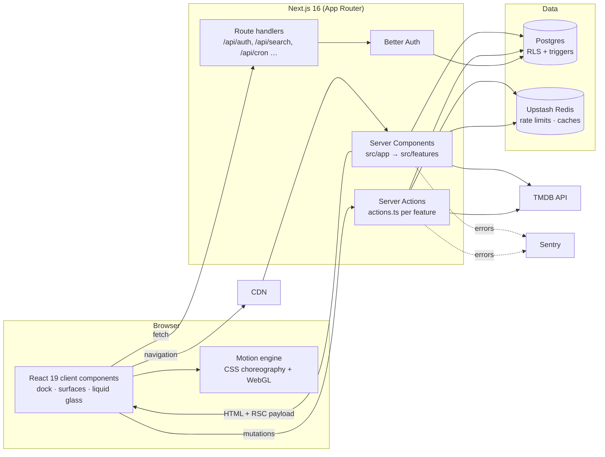
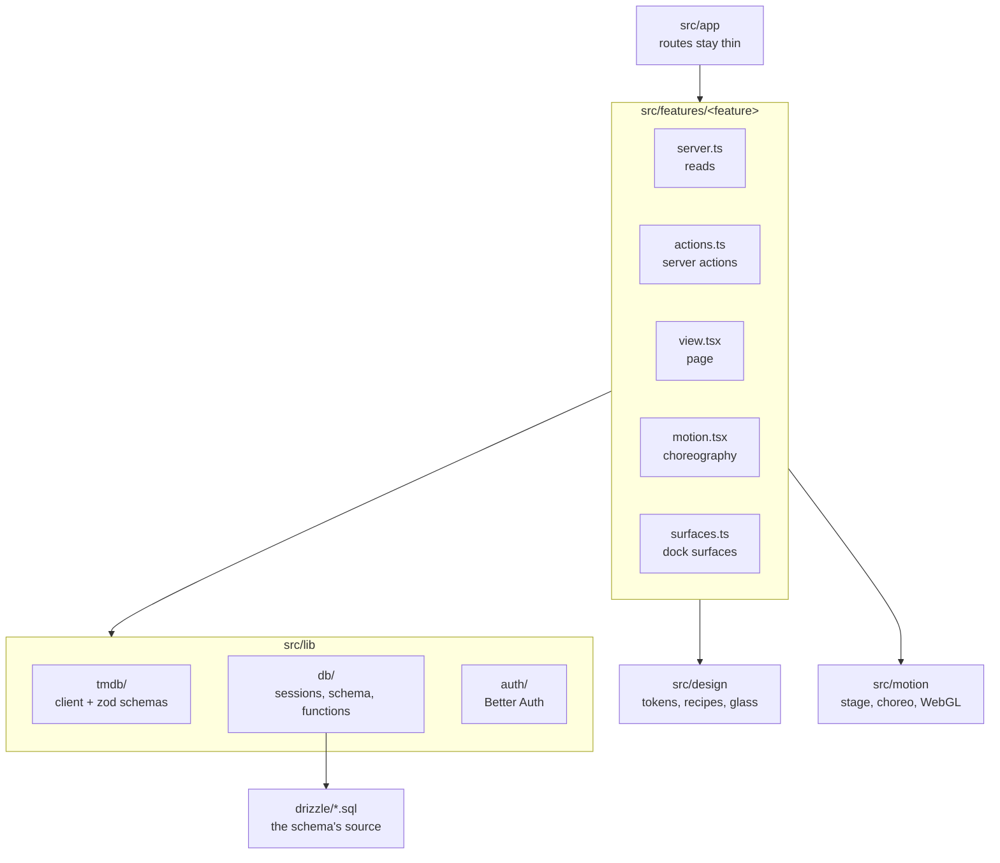

# Architecture

How Guffin works, drawn from the code. Each page takes one subsystem and
follows a real request through it, from the browser to the database and
back. The diagrams are [Mermaid](https://mermaid.js.org), so GitHub draws
them in place.

| Page                                  | What it explains                                                                |
| ------------------------------------- | ------------------------------------------------------------------------------- |
| [Rendering a page](rendering.md)      | From a URL to pixels: RSC, streaming, the per-page palette, the motion stage    |
| [Catalog: TMDB](catalog.md)           | The TMDB transport (zod, retries, caching) and the local `film_catalog`         |
| [Data access and RLS](data-access.md) | `viewer` / `asViewer` / `admin` sessions, Row Level Security, triggers as logic |
| [Authentication](auth.md)             | Better Auth: email codes, passkeys, OAuth, sessions, the first sign-in          |
| [Accounts and privacy](accounts.md)   | The account row, private profiles, what a visitor may see                       |
| [Movie library](movie-library.md)     | Watched, diary, watchlist, likes, favourites, and the rules that bind them      |
| [Reviews](reviews.md)                 | Film reviews and list comments in one table; ratings and stats                  |
| [Social graph](social.md)             | Follows and requests, notifications, the activity feed, lists                   |
| [Algorithms](algorithms.md)           | Quality scoring, rank fusion, trending heat, search ranking, recommendations    |

## The system at a glance

Two sources of truth meet on every page:

- **The catalogue** (films, people, images) comes from TMDB. It is
  never copied wholesale. Responses are cached by Next's fetch cache, and
  library rows keep a small snapshot of each film (see [catalog](catalog.md)).
- **User data** (library, diary, reviews, follows) lives in Postgres. Most of
  the domain rules sit in the database: Row Level Security decides who may
  read a row, and triggers keep counters, activity and notifications in step
  (see [data access](data-access.md)).

## Code map

A feature keeps everything it owns next to itself: reads, mutations, the
page, its motion and its dock surfaces. Routes in `src/app` only parse
parameters and hand off.
