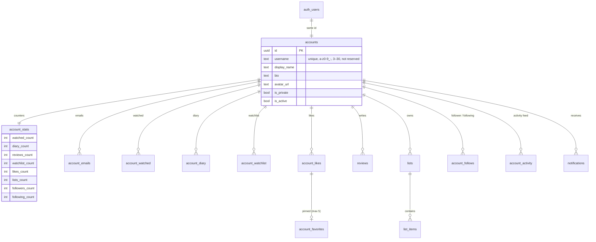
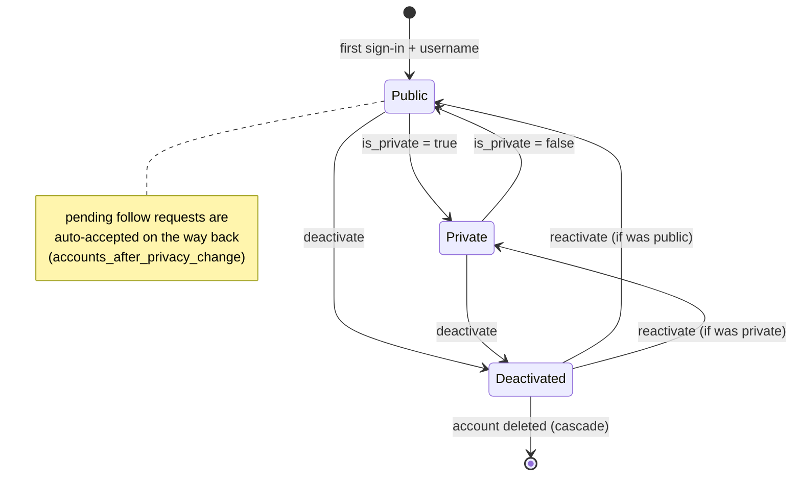
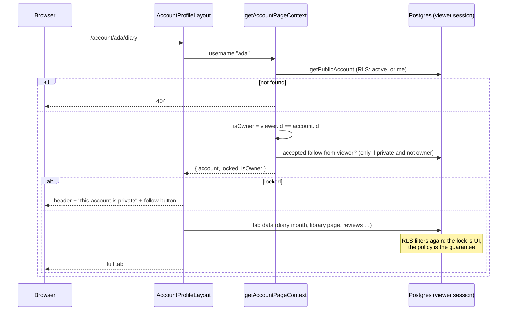

# Accounts and privacy

An **account** is the public face of a user: username, display name, bio,
avatar, background, and one privacy switch. It is created by a trigger on
the first sign-in (see [auth](auth.md#the-first-sign-in-creates-the-account))
and lives at `/account/<username>`.

## The data around an account

`account_stats` is never recomputed on read. Triggers on each table add or
subtract one as rows come and go (see
[data access](data-access.md#triggers-carry-the-domain)), so a profile
header is one row read.

## Usernames

A username is normalised in the app (lowercased, accents stripped, anything
else turned into `-`). The database checks it again:
`^[a-z0-9][a-z0-9_-]{1,28}[a-z0-9]$`, and it must not be a reserved word
(`settings`, `api`, `diary`, `lists`, …) that would clash with a route.
`update_account()` changes only the fields it is given. Everything else is
passed as the `'__UNCHANGED__'` sentinel.

## Public, private, deactivated

- **Private** hides the library, diary, reviews and activity from anyone who
  is not an accepted follower. New follows become requests.
- **Deactivated** (`is_active = false`) hides the account from everyone but
  its owner: RLS treats an inactive owner as invisible.
- **Deactivate / reactivate** are `deactivate_current_account()` and
  `reactivate_current_account()`; `is_private` is kept, so an account comes
  back as it was.
- **Deleted** removes the `auth_users` row, and every table cascades from
  it.

## Visiting a profile

`/account/[username]/<tab>` renders on the server. The page context decides
between the full profile and a locked header:

The `locked` flag only decides what to render. Even if a locked page asked
for diary rows, the read policy would return none, so the lock can never
leak data.

## Profile tabs

| Tab                         | Source                                                                                        |
| --------------------------- | --------------------------------------------------------------------------------------------- |
| Overview                    | `get_account_overview()`: favourites, recent diary, popular and recent reviews, rating spread |
| Activity                    | `account_activity`, paginated, plus a calendar summary                                        |
| Diary                       | `account_diary` by month                                                                      |
| Watched / Watchlist / Likes | `account_watched` / `account_watchlist` / `account_likes`, filterable                         |
| Reviews                     | `reviews` by the account, with filters                                                        |
| Lists                       | `lists` (+ items, likes, comments)                                                            |
