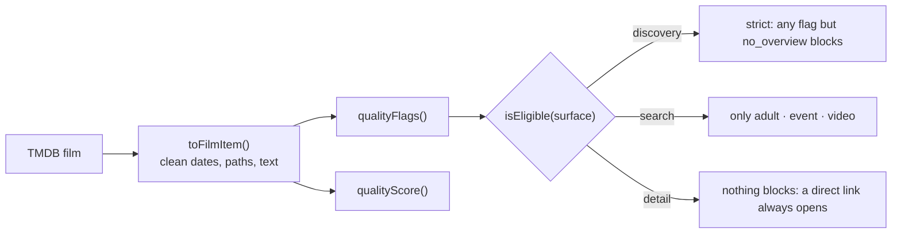
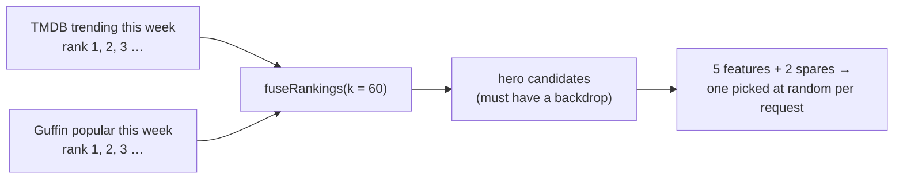
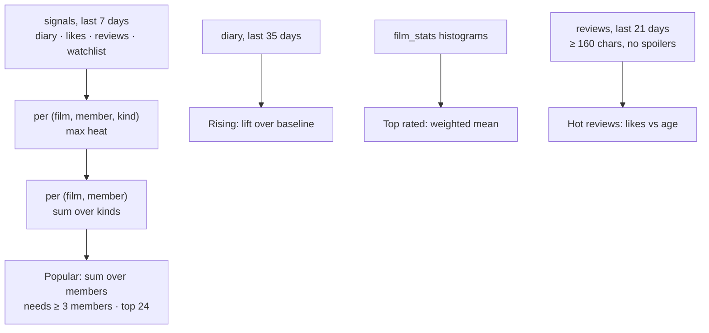
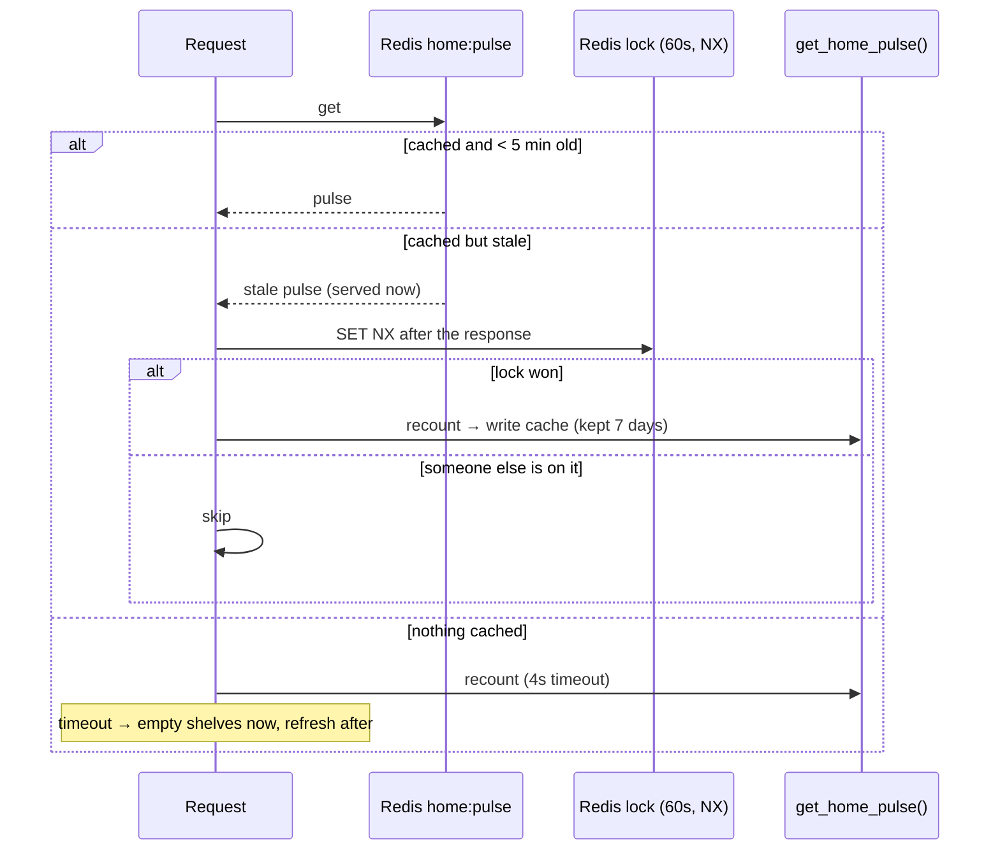
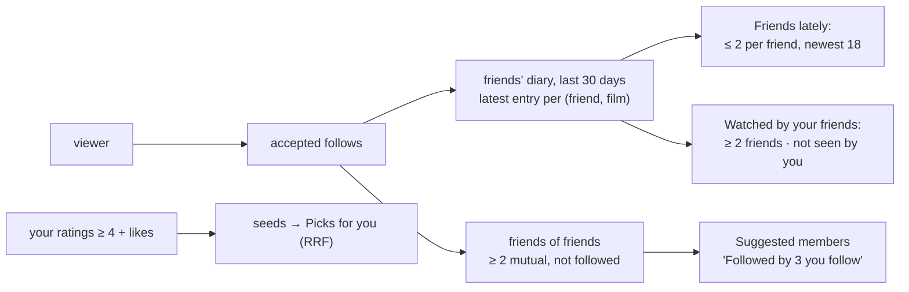
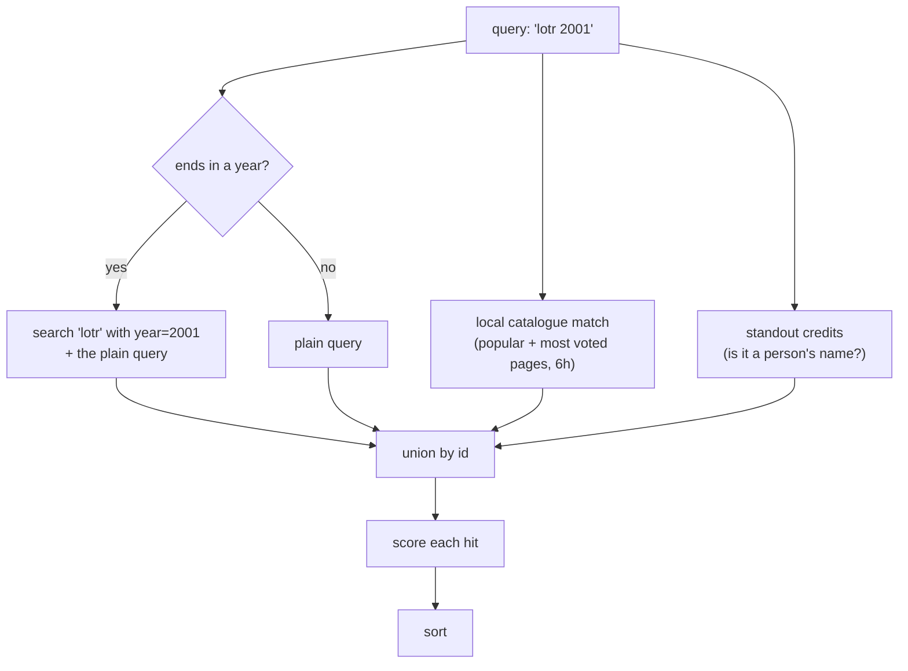

# Algorithms

The ranking, scoring and selection logic behind Guffin's shelves and
search. Each section names the formula and the file it lives in.

## Catalogue quality

Scores are computed when the catalogue is built and stored on `film_catalog` (`quality_score`, `quality_flags`); the app reads them, it never recomputes them.

TMDB has millions of entries: concert films, award shows, adult titles,
films with no poster. Each title gets **flags** and a
**score** before it reaches a shelf.



| Flag                     | Raised when                                                  |
| ------------------------ | ------------------------------------------------------------ |
| `adult`                  | TMDB marks it adult                                          |
| `no_poster`              | no poster image                                              |
| `no_overview`            | empty synopsis (recorded, blocks nothing)                    |
| `no_date` / `unreleased` | no release date / dated in the future                        |
| `low_votes`              | fewer than 40 votes                                          |
| `video`                  | a TMDB "video" entry                                         |
| `event_title`            | title looks like a concert, ceremony or special (`rules.ts`) |

### The score

```text
score = 0.60 · bayes/10  +  0.25 · popularity  +  0.15 · community

bayes      = (v / (v + m)) · R  +  (m / (v + m)) · C
             R = TMDB average, v = votes, m = 250, C = 6.4
popularity = min(1, log10(1 + tmdb_popularity) / 3)
community  = (guffin_average / 5) · min(1, guffin_ratings / 50)
```

The **Bayesian average** pulls a title with few votes toward the global
mean, so a 9.8 from 12 votes ranks below an 8.4 from 30,000. Popularity is
logarithmic and capped, so a viral week can't outweigh quality. The
community term only counts once Guffin's own ratings approach 50.

## Reciprocal rank fusion

`src/features/home/queries.ts` → `fuseRankings`

Several ranked lists are merged without comparing their scores, only their
positions:

```text
score(item) = Σ over lists   1 / (k + rank + 1)
```



A film high on both lists wins. A film on one list still competes. The
same fusion (with `k = 10`, favouring the top of each list) builds
**Picks for you**: up to three of your seed films (rated ≥ 4 or liked) each
bring TMDB's recommendations, and fusion ranks films recommended by several
seeds first, minus anything you've seen.

## Trending heat

`get_home_pulse()` (SQL), cached in Redis

What members are into **this week**. Only public, active accounts count.

```text
heat(signal) = weight · e^(−age / 3 days)

weight:  written review 2.0 · like 1.5 · diary log 1.0 · bare rating 0.75 · watchlist 0.5
```



- **One member, one vote per kind.** Heat is taken as the max per kind, then
  summed per member. Ten diary entries from one person can't make a film
  popular.
- **Rising** compares this week to the four weeks before:

  ```text
  lift  = (week + 1) / (previous_4_weeks / 4 + 1)
  order = ln(1 + week) · lift          needs week ≥ 4
  ```

  The `ln` keeps a jump from 0 to 4 viewers from beating 40 to 120.

- **Top rated** is a Bayesian mean on Guffin's own ratings, with 30 phantom
  votes at the site-wide mean `C` and at least 15 real ratings:
  `(n · avg + 30 · C) / (n + 30)`.
- **Hot reviews** use a gravity curve (like Hacker News):
  `(likes + 1) / (hours_old + 6)^1.2`. Only the best review per film, then
  the best per author, so one prolific writer can't fill the shelf.
- **Top lists**: `recent_likes + 2·ln(1 + likes) + 3·e^(−age/30 days)`,
  public lists with at least 5 items.

### Stale-while-revalidate with a lock



The expensive query runs at most once per five minutes no matter the
traffic, and no visitor ever waits for it except the very first.

## Your circle

`get_home_circle()` (SQL), per viewer



Suggested members come first. The rest of the six slots go to the month's
most liked reviewers you don't follow yet.

## Search ranking

`src/features/search/queries.ts`

TMDB's own search order is weak for short or partial queries. Guffin runs
several searches in parallel and re-ranks the union:



```text
score = match + year_bonus + 0.5 · fame + 0.15 · order − 0.2 · (no poster)
```

`match` is a ladder over folded text (lowercased, accents and `&` folded,
leading _the / a / an_ ignored):

| Match                                    | Score           |
| ---------------------------------------- | --------------- |
| exact                                    | 1.00            |
| whole-word prefix (`star` → _Star Wars_) | 0.85            |
| acronym (`lotr`, `tgbu`)                 | 0.82            |
| partial prefix                           | 0.80            |
| phrase inside                            | 0.60 + coverage |
| phrase at a word start                   | 0.55 + coverage |
| every word present                       | 0.40 + coverage |
| substring / some words                   | ≤ 0.35          |

Acronyms are checked against the full title, the title before a subtitle,
and the title without a sequel number or _and…_ tail. That way `lotr`
finds _The Lord of the Rings: The Fellowship of the Ring_. `fame` blends
log popularity and log vote count normalised within the result set. `order`
keeps a little of TMDB's own ranking. The client debounces typing by 250ms
and asks for every result type in one batched request.

## Theatres and coming soon

Now playing films need a poster, 25+ votes and a release date on or before
today. The 12 most popular are kept, then shown newest first. Upcoming
films (two TMDB pages) must be dated after today. The 12 most popular are
shown soonest first. Each carries a _waiting_ count: how many members have
it on their watchlist.

## Spotlights

`src/features/spotlights/queries.ts`

- **IMDb Top 100** is a fixed list of IMDb ids. Each id is resolved through
  TMDB's `find`. A result whose year is more than one year off, or that has
  no poster, is dropped and reported, so a bad mapping never shows the
  wrong film.
- It is slow to build, so it is kept in Redis for a week and rebuilt
  in the background after a day. Concurrent cold requests share one build
  (an in-flight promise map).

## Ratings histogram

Each title's ratings are a 10-slot array (one per half star) updated with
±1 per write. Averages, counts and the distribution chart all read it in
constant time. See [reviews](reviews.md#ratings-as-a-histogram).
