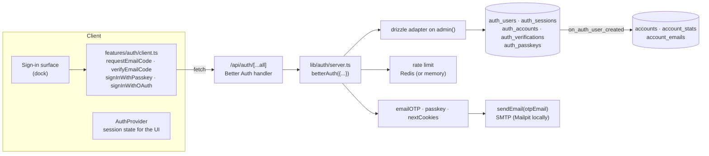
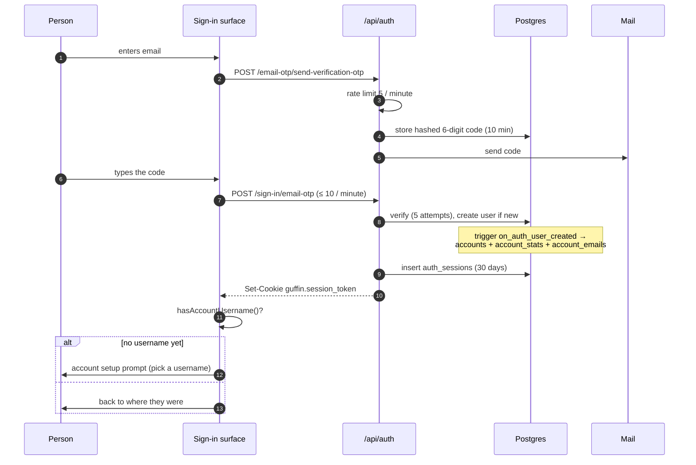
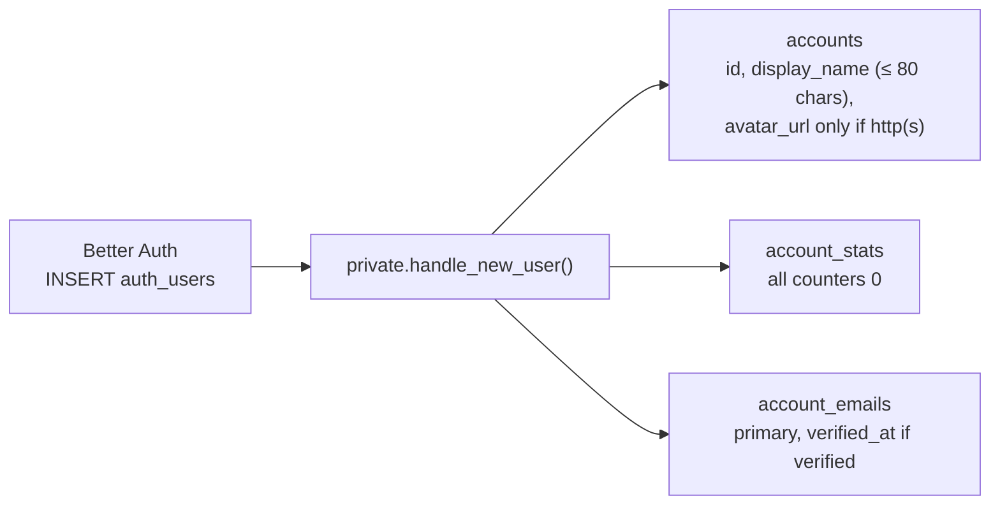
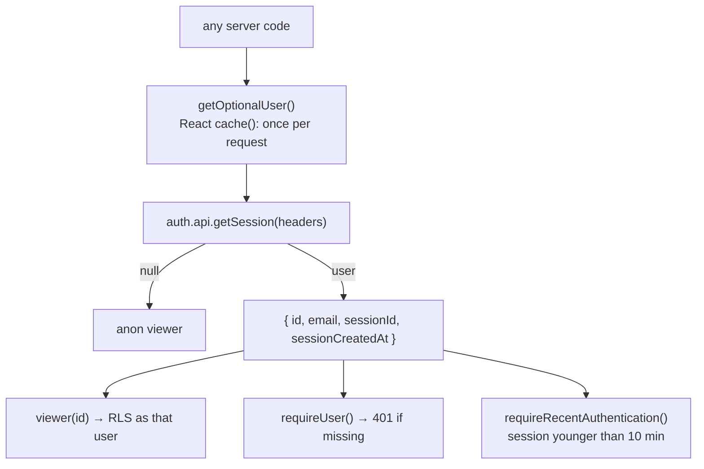

# Authentication

Self-hosted [Better Auth](https://www.better-auth.com) on the same Postgres.
There are no passwords: a person signs in with a **one-time email code**, a
**passkey**, or **Google / GitHub / X**.

## Pieces

The `auth_*` tables belong to Better Auth and only the owner role can touch
them. Everything else in the app is keyed by the same user id.

## Signing in with an email code

OAuth follows the same ending. The provider redirects to
`/auth/callback?next=…`. The callback route checks the session, then sends
the person either to account setup (no username yet) or to the sanitised
`next` path. `sanitizeNextPath` only accepts same-origin paths (`/…`, never
`//…`), so the callback cannot become an open redirect.

## The first sign-in creates the account

Better Auth inserts the user. A database trigger, not app code, builds the
rest of the account in the same transaction:

A user with no `username` yet is a half-made account: they are signed in,
but their profile has no URL until they pick a name.

## Sessions on the server

| Setting                   | Value                                                    |
| ------------------------- | -------------------------------------------------------- |
| Session lifetime          | 30 days, refreshed once a day of use                     |
| "Fresh" session           | 1 day (Better Auth); deleting the account needs ≤ 10 min |
| Cookie prefix             | `guffin`                                                 |
| Account linking           | enabled; Google and GitHub are trusted to link by email  |
| Client IP for rate limits | `cf-connecting-ip` → `x-real-ip` → `x-forwarded-for`     |

Deleting the account (`DELETE /api/account/me`) goes through
`requireRecentAuthentication`. It also requires typing `DELETE` and a
same-origin request. A session older than ten minutes is asked to sign in
again. The delete removes the `auth_users` row. Every account table hangs
off it with `ON DELETE CASCADE`, so the rest goes with it.

## Housekeeping

`/api/cron/prune` calls `prune_account_data()`. It deletes expired sessions
and verification codes more than a day past expiry. Old read notifications
are pruned separately (see [social](social.md#notifications)).
