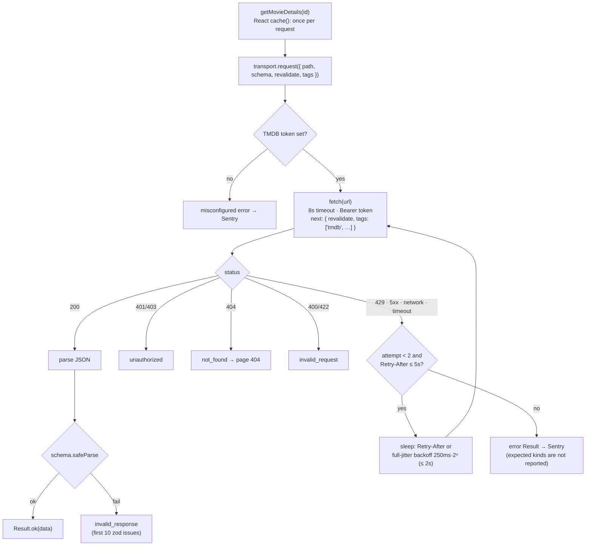

# Catalog: TMDB

Guffin owns no film data. Titles, people, images and credits come from
[TMDB](https://www.themoviedb.org) on demand. Postgres keeps only small snapshots
on library rows and an optional `film_catalog` mirror.

## The TMDB transport

Every call goes through one transport (`src/lib/tmdb/transport.ts`). Domain
clients (`movies`, `people`, `discover`, `awards`) only describe a
path, a zod schema and a cache lifetime.

- **Nothing throws.** The transport returns a `Result<T, TmdbError>`. Callers
  decide what a failure means: a 404 page, an empty shelf, a toast.
- **Every payload is validated.** zod schemas turn TMDB's snake_case JSON
  into typed camelCase objects. A malformed response fails loudly instead of
  leaking `undefined` into the UI.

### Cache lifetimes (`TMDB_REVALIDATE`)

| Data                          | Revalidate |
| ----------------------------- | ---------- |
| Movie, person                 | 6 hours    |
| Awards                        | 24 hours   |
| Search                        | 1 hour     |
| Feeds (trending, now playing) | 30 minutes |

Two cache layers stack: React `cache()` dedupes within one request (page +
metadata + nested components). Next's fetch cache shares responses across
requests and users.

## `film_catalog`: the local mirror

`film_catalog` holds one row per film with TMDB facts SQL can use: genres,
language, votes, popularity and the **quality flags and score**. The profile
pages left-join it for their genre, decade and language facets. The app never
fetches TMDB to fill it; the seed scripts write it. A trigger applies `film_catalog_overrides` on every write, so manual fixes
win over TMDB.

The same scoring also filters every discovery shelf and search result (see
[algorithms](algorithms.md#catalogue-quality)).

## Snapshots instead of joins

Library rows (`account_watched`, `account_diary`, `reviews`, `lists`…) store
a snapshot of the title: `title`, `poster_path`, `backdrop_path`,
`release_date`. A profile page with 500 films renders from Postgres alone,
without 500 TMDB calls. The snapshot is written when the row is created
(`movieSnapshot()`), so a renamed title keeps its old name until it is
logged again. That is the accepted trade-off.
