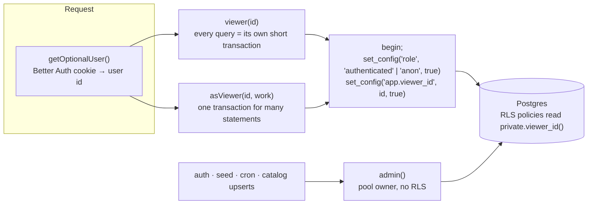
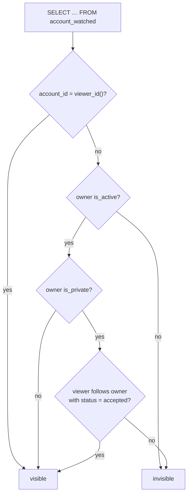
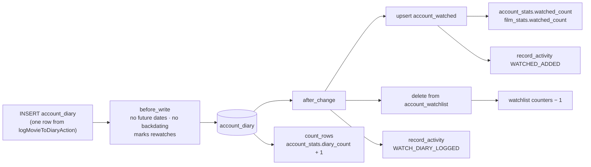
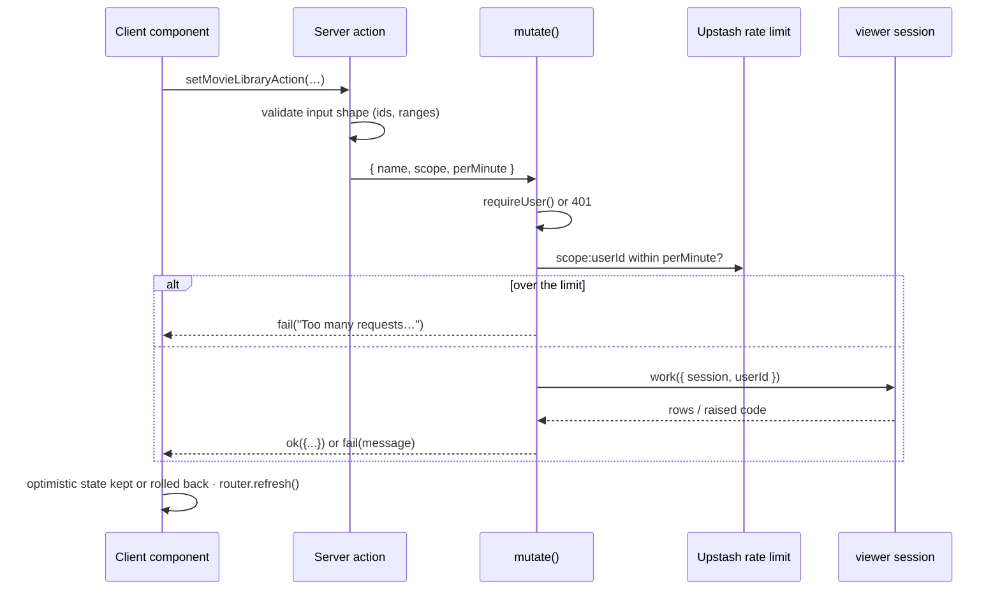

# Data access and RLS

Guffin does not check permissions in application code. Every query runs as
a Postgres role scoped to the current viewer, and **Row Level Security**
decides which rows exist for them. Domain rules that must always hold
(counters, activity, notifications, cross-table consistency) are
**triggers**. So they hold no matter which code path wrote the row.

## Three kinds of session

`src/infrastructure/db/client.ts` hands out a `Session`: a Drizzle database plus a
typed `call()` for SQL functions.



```sql
-- what every viewer query is wrapped in
begin;
select set_config('role', 'authenticated', true),
       set_config('app.viewer_id', '6f1c…', true);
-- … the actual query …
commit;
```

- `set_config(…, true)` is **transaction-local**. A pooled connection never
  carries one user's identity into another request.
- A signed-out visitor runs as `anon` with no viewer id. The same policies
  serve them.
- The viewer id is checked against a UUID pattern before it is put into
  the scope statement.
- `admin()` is the pool owner and bypasses RLS. It is used only for Better
  Auth's adapter, seeding, cron jobs, catalogue upserts and cached
  site-wide aggregates (`get_home_pulse`).

## Who can see a row

Most user tables share one read policy. A row is visible when it is yours,
or its owner is active and either public or followed by you (accepted).



The same rule (`private.can_view_account`) guards `account_watched`,
`account_diary`, `account_likes`, `account_watchlist`, `account_favorites`,
`account_stats`, `account_activity` and `reviews`. Lists add their own `is_private` flag on
top. Writes (`INSERT/UPDATE/DELETE`) are granted to `authenticated` only and
limited to your own rows. Catalogue tables (`film_catalog`, `film_stats`) are readable by everyone.

## Triggers carry the domain

A server action writes **one row**. The database does the rest in the same
transaction:



Patterns used everywhere:

| Pattern               | How                                                                                                                                   |
| --------------------- | ------------------------------------------------------------------------------------------------------------------------------------- |
| **Counters**          | `count_rows` / `count_film_rows` add ±1 to `account_stats` and `film_stats` on insert/delete; never recomputed on read                |
| **Immutable keys**    | `forbid_column_change` stops a row from being moved to another account or title                                                       |
| **Idempotent events** | `record_activity` and `notify` upsert on a **dedupe key** (`watched:603`, `review-like:<review>:<actor>`), so retries never duplicate |
| **Undo is symmetric** | every delete path calls `remove_activity` / `unnotify` with the same key                                                              |
| **Errors as codes**   | rule violations raise `DIARY_DATE_IN_FUTURE`, `DIARY_DATE_BEFORE_LATEST_ENTRY`…; actions map the code to a human message              |
| **Security definer**  | trigger functions run as owner with `search_path = ''` and fully qualified names                                                      |

## Typed SQL functions

`npm run db:schema` reads the live database and generates `schema.ts`
(Drizzle tables) and `functions.ts` (argument and return shapes for every
`public.*` function). `session.call()` builds a call with named parameters
and explicit casts:

```ts
await session.call("reorder_list_items", {
  p_list_id: listId,
  p_tmdb_ids: [603, 27205, 157336],
});
// → select * from public.reorder_list_items(p_list_id => $1::uuid, …)
```

## Mutations: one wrapper

Server actions that write go through `mutate()` (`src/features/auth/server.ts`):



An unexpected exception is reported to Sentry and becomes a generic,
user-safe message. Known database codes become specific ones.

## Migrations

`drizzle/*.sql` is the schema's source of truth, written by hand:
`db:new <name>` → write SQL → `db:migrate` → `db:schema`. `0000_baseline.sql`
holds the full, film-only schema. Later migrations change it in small steps.
