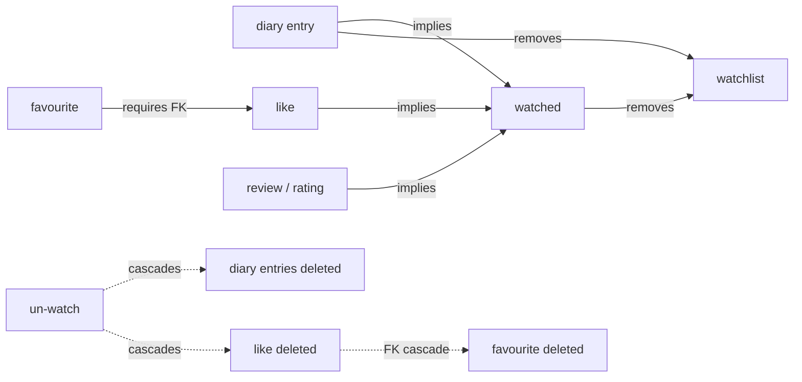
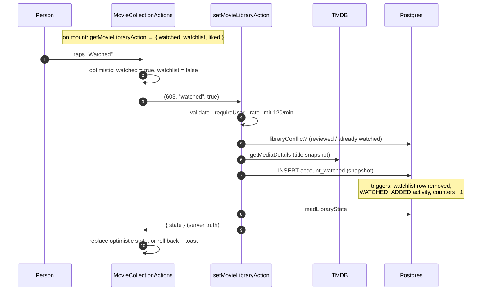
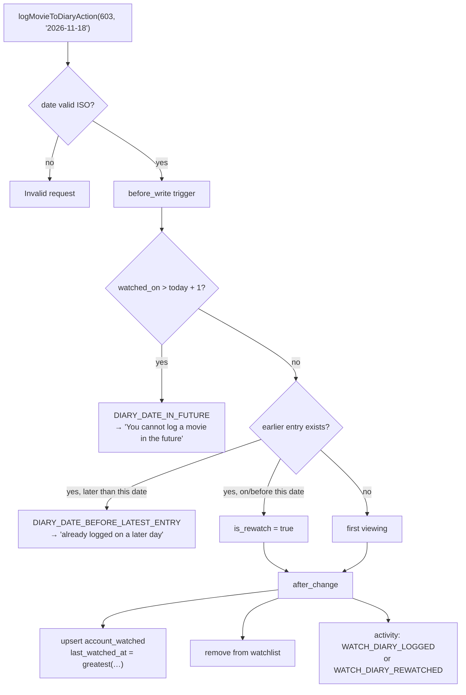
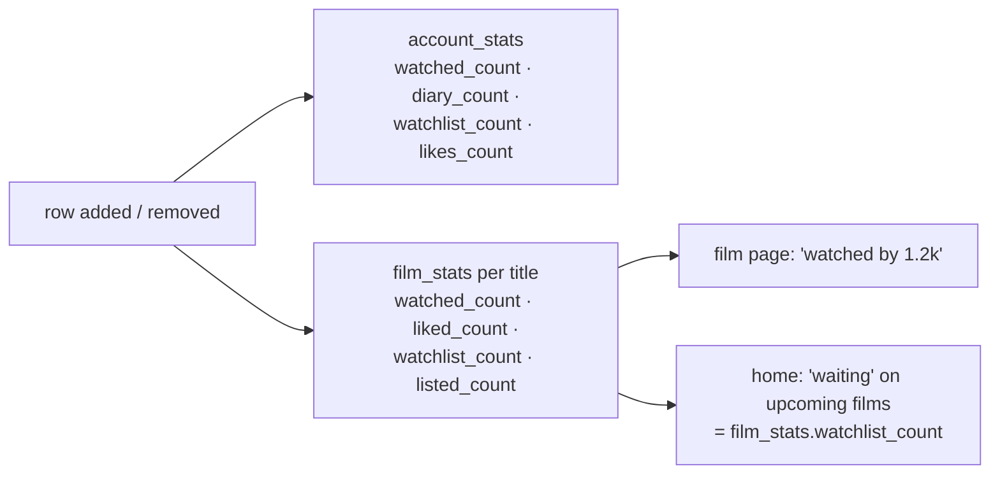

# Movie library

A person's relationship with a film is spread across five tables. Each one
answers a different question:

| Table               | Question                          | Cardinality                              |
| ------------------- | --------------------------------- | ---------------------------------------- |
| `account_watched`   | Have I seen it?                   | one row per film                         |
| `account_diary`     | When did I watch it?              | one row per viewing (dated)              |
| `account_watchlist` | Do I want to see it?              | one row per film                         |
| `account_likes`     | Did I love it?                    | one row per film                         |
| `account_favorites` | Is it one of my five?             | ≤ 5 rows, each needs a like              |
| `reviews`           | What did I think? (rating + text) | one per film (see [reviews](reviews.md)) |

## How the tables imply each other

The UI writes one table. Triggers keep the others consistent, so the rules
hold for any code path, including seeds and scripts.

| Rule                                       | Where it lives                                                                    |
| ------------------------------------------ | --------------------------------------------------------------------------------- |
| Logging, liking or reviewing marks watched | `account_diary_after_change`, `account_likes_after_change`, `reviews_after_write` |
| Watched leaves the watchlist               | `account_watched_after_insert`, `account_diary_after_change`                      |
| Un-watching drops diary and like           | `account_watched_after_delete`                                                    |
| A favourite needs a like                   | FK `account_favorites → account_likes` (`ON DELETE CASCADE`)                      |
| A reviewed film can't be un-watched        | server check in `setMovieLibraryAction` (`libraryConflict`)                       |
| A watched film can't join the watchlist    | server check (`libraryConflict`); the UI hides the button too                     |

## Toggling a mark from the film page

The client predicts the outcome with the same rules the database applies
(`applyMovieLibraryChange`: watched clears watchlist, un-watched clears
like), so the buttons don't flicker while the round-trip completes.

## The diary

A diary entry is a dated viewing. Rewatches are new rows, never edits.

`today + 1` leaves room for time zones: someone ahead of UTC can log
"tonight" before the server's date has turned.

## Favourites

Five slots per media type. `setFavoriteAction` reads the used positions and
takes the first free one. An insert without a matching like fails the
foreign key (`23503`), which becomes "Like this movie to pin it".

## Counters and film stats

Every insert or delete on these tables moves two sets of counters:

Counters clamp at zero (`greatest(0, …)`) so a replayed delete can never
push them negative.
