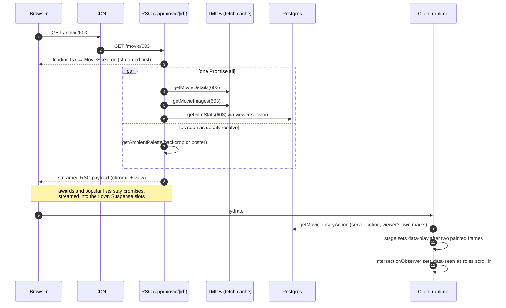
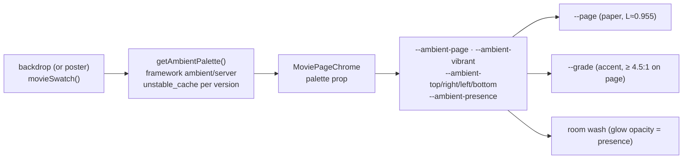
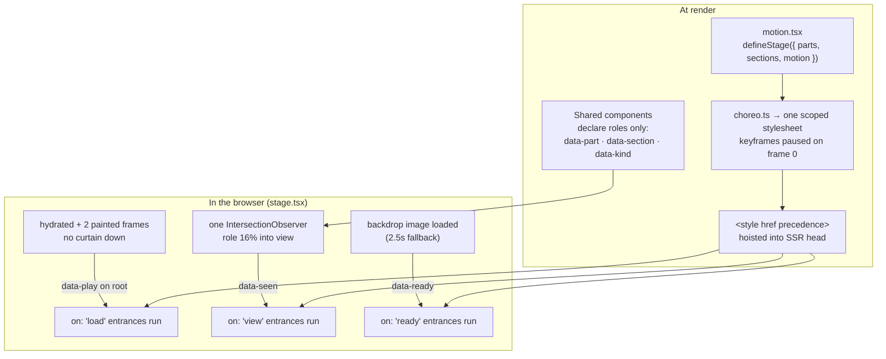
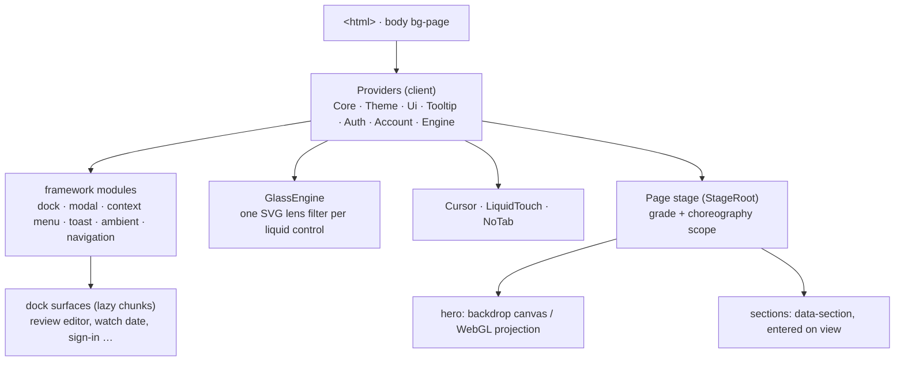

# Rendering a page

What happens between typing `/movie/603` and seeing the film's hero fade in.
The movie page is the example; person and profile pages follow the same
shape.

## The request, end to end

Some choices that shape this:

- **The page is the same for everyone.** The server part of `/movie/[id]`
  reads only public data: TMDB plus aggregate `film_stats`. The viewer's
  own state (watched? on the watchlist? rated?) is fetched after hydration
  by `MovieCollectionActions` through `getMovieLibraryAction`. Personal state
  never blocks the first paint.
- **The CSP is static.** It is set in `next.config.mjs`; a per-request
  nonce would force a server render on every hit and rule out CDN caching.
- **Slow parts are passed down as promises.** `getMovieAwards` and
  `getMoviePopularLists` start in the page and resolve inside their own
  Suspense boundaries, so the hero does not wait for them.
- **Request-level dedupe.** TMDB getters are wrapped in React `cache()`, so
  `generateMetadata` and the page share one `getMovieDetails` call per
  request. Across requests, Next's fetch cache holds the response (see
  [catalog](catalog.md)).
- **Missing vs broken.** A TMDB `not_found` becomes `notFound()` (404). Any
  other failure throws, and `error.tsx` renders.

## Where the page's colour comes from

Every detail page is tinted by its own artwork. The server picks one image,
extracts a palette, and the client turns it into CSS variables.

The palette is computed once per image and analysis version, then cached.
`--grade` is the picture's most vivid colour mixed into ink by how colourful
the picture is, so a grey film gets a quiet accent and a neon one a loud
accent. The colour system is described in `docs/design/03-colour.md`.

## Motion: compiled to CSS, triggered by attributes

Motion is part of the product, but very little of it runs as JavaScript. A
page declares its choreography in its own `motion.tsx` with `defineStage`.
The stage compiles it into **one stylesheet** scoped to `[data-choreo=…]`.
React 19 hoists that stylesheet into the server-rendered `<head>`. JavaScript
only flips attributes.

- **Roles vs choreography.** Shared components (`MediaCard`, headings,
  carousels) never animate themselves. They state what they are
  (`data-part="poster"`, `data-kind="media"`), and each page decides how that
  role moves. The same card can drift in on the home page and stay still in
  search.
- **Curtains.** An element with `data-curtain` holds `data-play` back (up to
  12s). The detail marquee uses one: the page starts when its dive fades.
- **Opening hold.** Roles already in view on arrival wait `opening` seconds,
  so the first screen plays top-down instead of all at once.
- **One-shot.** A role plays the first time it is seen and never replays.
- **Timing** uses the golden ratio: `beat(n) = φⁿ` seconds (0.236, 0.382,
  0.618, 1, 1.618…), stretched per stage by `tempo` and `reach`.

## The layers on screen

`@omerdlw/base-framework` supplies the dock, modal, surface and navigation
behaviour with **no design of its own**. Guffin passes in every class, colour,
duration, z-index and icon (`src/design/theme`). Dock surfaces such as the
review editor are lazy chunks (`lazySurface`), preloaded when the control
that opens them mounts.
