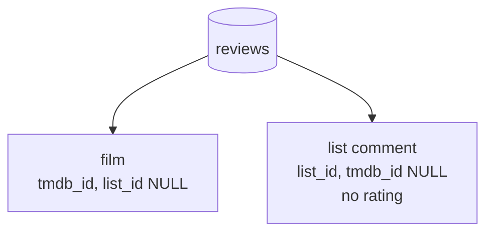
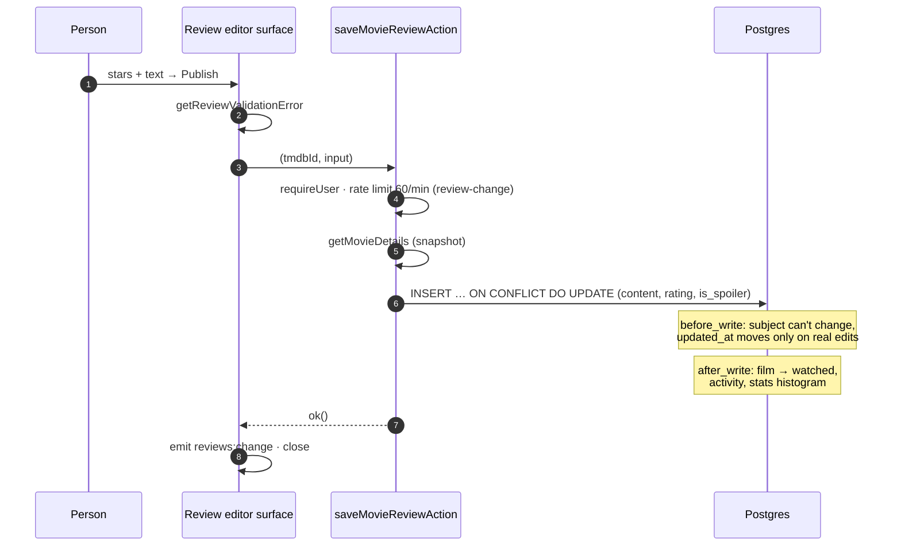
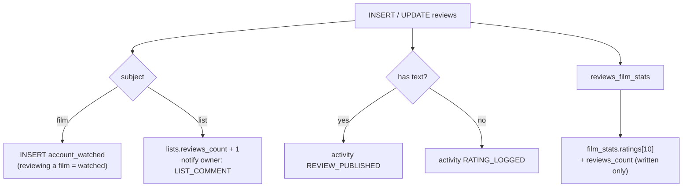
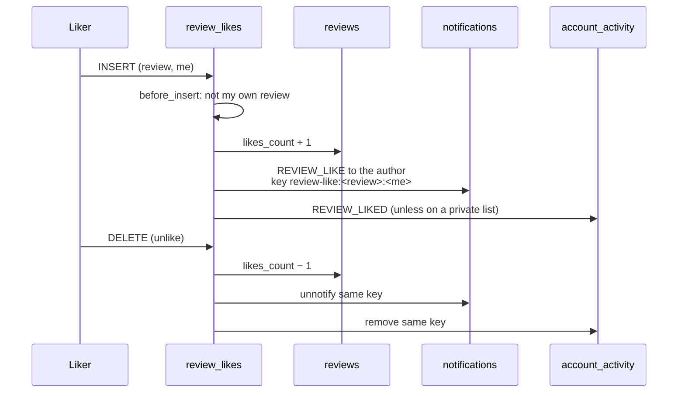

# Reviews

One `reviews` table holds everything a person says about something: a
star rating, a written review, or both. What the review is _about_ is
decided by which keys are filled in:



A partial unique index on `(account_id, tmdb_id)` (and one on
`(account_id, list_id)` for comments) keeps **one review per person per
subject**. Saving again is an upsert, not a second review. A bare rating is
also a `reviews` row with empty content, so ratings and reviews are counted,
sorted and shown the same way.

## Validation

| Field        | Rule                                                  |
| ------------ | ----------------------------------------------------- |
| `rating`     | `null` or 0.5 – 5 in half steps                       |
| `content`    | empty, or 10 – 800 characters                         |
| either       | at least one of rating or content                     |
| list comment | text required, rating forbidden; not on your own list |
| `is_spoiler` | only kept when there is text                          |

The same `getReviewValidationError` runs in the editor (instant feedback)
and in the server action.

## Saving a review



## What the triggers do



An edit to an existing review **edits its activity item in place**
(`edit_activity`) instead of posting a new one. Adding text to a bare rating
re-publishes it as `REVIEW_PUBLISHED`.

## Ratings as a histogram

Ratings are never averaged on the fly from all rows. Each title keeps a
10-slot array, one slot per half star:

```text
rating   0.5  1   1.5  2   2.5  3   3.5  4   4.5  5
slot      1   2    3   4    5   6    7   8    9   10      slot = rating × 2
ratings [ 0,  1,   0,  3,   2,  9,  14, 31,  22, 17 ]
```

`shift_rating(ratings, old_slot, new_slot)` moves one vote when a rating
changes: −1 from the old slot, +1 to the new one, clamped at zero. Insert
and delete are the same call with one side `NULL`. The distribution chart,
the average and the count all come from this one array, in O(1) per write.

## Likes on reviews



Liking, unliking and liking again leaves exactly one notification, because
it is keyed by review and actor and refreshed in place.

## Reading reviews

- `/movie/[id]/reviews` pages 20 at a time. Sorts:
  newest / oldest (by last edit), rating ↑↓, likes ↑↓. Filters: all, written,
  or one star value.
- `get_review_stats` counts on read: the average (one decimal), how many
  rated, and how many entries, for a film, optionally for one author. It runs with the viewer's rights, so RLS
  shapes the numbers too. The stored `film_stats` histogram feeds the
  site-wide spread and the home page's top-rated shelf.
- RLS applies as everywhere: reviews by private accounts appear only to
  their accepted followers, and comments on private lists only to people
  who can see the list.
