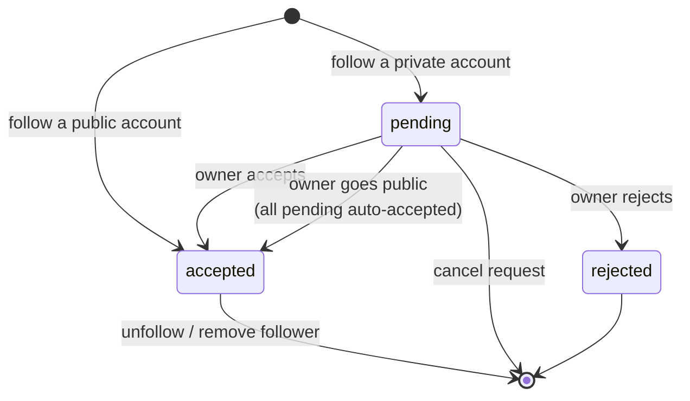
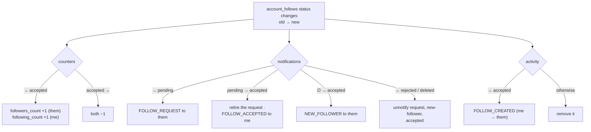
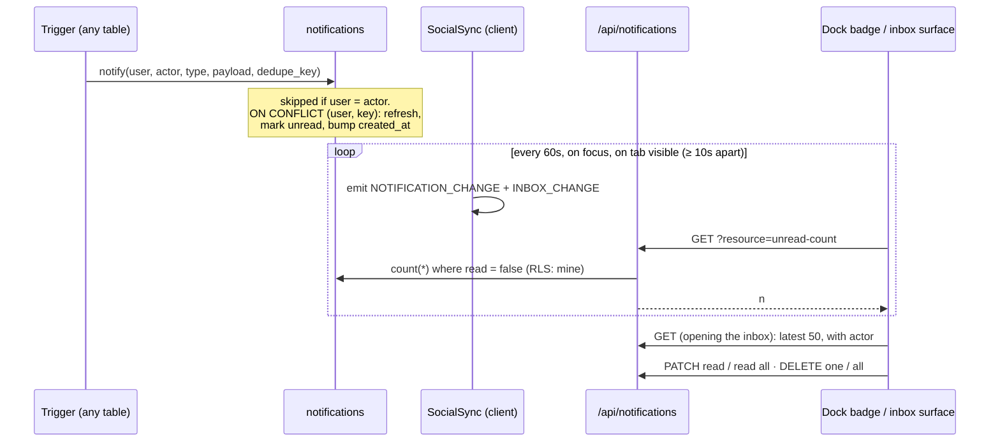
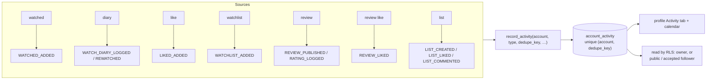
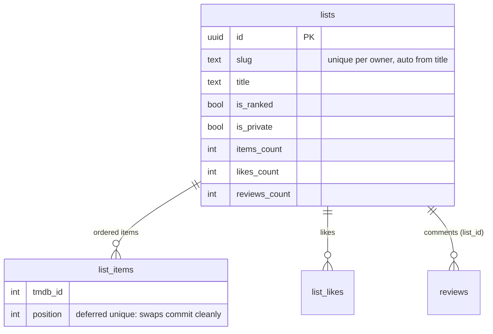
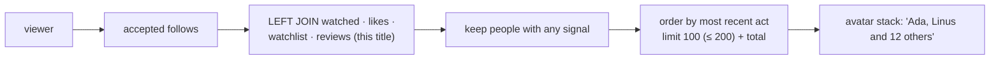

# Social graph

Following, follow requests, notifications, the activity feed and lists.
Nearly all of it is driven by triggers on a handful of tables. Application
code writes one row, and the side effects follow from it.

## Follows

`account_follows` holds one row per (follower, following) pair with a
status. A public account is followed at once; a private one gets a request.

Who may move a follow is checked in `account_follows_before_update`, not in
the route:

| Actor               | May set status to                                                                                              |
| ------------------- | -------------------------------------------------------------------------------------------------------------- |
| the followed person | `accepted` or `rejected`                                                                                       |
| the follower        | only the initial status (`pending` for private, `accepted` for public); an accepted follow can't be downgraded |
| anyone else         | nothing (`42501`)                                                                                              |

A follow can never be moved to other accounts. `followUserAction` simply
upserts the row with the status the target's privacy implies. The database
rejects anything else.

### One row change, many effects

Follow, unfollow and follow again leaves exactly one notification and one
activity item. Both are keyed (`new-follower:<me>`, `follow:<them>`).

## Notifications

| Type              | Fired by                              |
| ----------------- | ------------------------------------- |
| `FOLLOW_REQUEST`  | a follow of a private account         |
| `FOLLOW_ACCEPTED` | the request answered                  |
| `NEW_FOLLOWER`    | a follow of a public account          |
| `REVIEW_LIKE`     | a like on your review or list comment |
| `LIST_LIKE`       | a like on your list                   |
| `LIST_COMMENT`    | a comment on your list                |

There is no websocket. Notifications are pulled on a 60-second rhythm that
pauses in background tabs, which is enough for a diary. A daily prune drops
read notifications older than 90 days, except follow requests and
acceptances.

## The activity feed

Every meaningful act writes one `account_activity` row through
`record_activity`. A profile's _Activity_ tab and its calendar read from it.
The home page's friends shelf is built separately, straight from friends'
diaries (see [algorithms](algorithms.md#your-circle)).

- **Idempotent by key.** `watched:603`, `diary:<id>`. Re-doing an act updates the item instead of adding one.
  Undoing it removes the item with the same key.
- **Quiet acts.** Acts on private lists stay out of the feed.
- **Edits stay in place.** Editing a review rewrites its item and flags it
  `edited` instead of posting it again.

## Lists

- **Slugs** are made from the title by the insert trigger (`my-list`,
  `my-list-2`…) and can never change, so list URLs are permanent.
- **Counters** (`items_count`, `likes_count`, `reviews_count`) are trigger
  maintained, and a client can't set them.
- **Reordering** sends the full new order to `reorder_list_items`. It
  refuses any order that doesn't contain every item exactly once. Because
  the position constraint is deferred, a swap is valid at commit.
- **Privacy flips** move the list's activity: going private deletes it,
  going public creates `LIST_CREATED`. Film stats (`listed_count`) follow
  the same flip.

## Social proof on a title

A film page shows which of the people you follow have watched, liked,
watchlisted or reviewed it (`get_movie_social_proof`):

It runs with the viewer's rights (not security definer). Someone you follow
who has since gone private, without accepting you, drops out by RLS.
